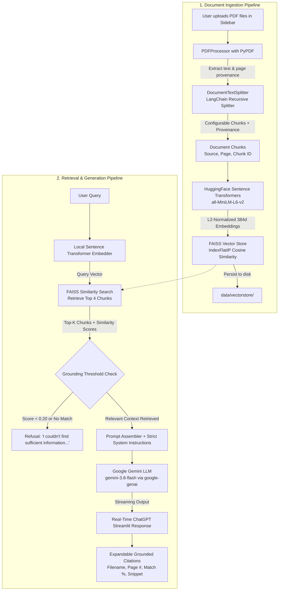

# RogeX – AI-Powered Document Intelligence & RAG Chatbot

<div align="center">

# ⚡ RogeX
### *"Your Documents. Your AI. Your Answers."*

**A Minimalist, ChatGPT-Style Conversational AI Chatbot with Strict Retrieval-Augmented Generation (RAG)**

[](https://www.python.org/)
[](https://streamlit.io/)
[](https://ai.google.dev/)
[](https://github.com/facebookresearch/faiss)
[](https://huggingface.co/sentence-transformers/all-MiniLM-L6-v2)
[](https://python.langchain.com/)
[](LICENSE)

</div>

---

## 📌 1. Project Introduction & Problem Statement

### The Problem
Traditional Large Language Models (LLMs) suffer from hallucinations, lack access to private enterprise documents, and often invent plausible-sounding facts and fictitious academic citations. Furthermore, existing document search tools often force users into complicated, cluttered dashboards full of unnecessary graphs, distraction-heavy animations, and confusing multi-page navigation when all the user wants is a simple, intuitive conversation with their documents.

### Project Objective
**RogeX** solves this problem by delivering a clean, minimalist, ChatGPT-style conversational AI experience powered by an actual, production-ready Retrieval-Augmented Generation (RAG) pipeline. Users can upload one or multiple PDF documents, ask questions in plain language, and receive accurate, intelligent answers grounded exclusively in their uploaded texts.

---

## ✨ 2. Key Features

* **💬 ChatGPT-Style Conversational Interface**: Distraction-free, warm off-white minimalist UI inspired by ChatGPT and modern component design libraries (21st.dev, Aceternity). No moving backgrounds, no particles, no clutter.
* **⚡ Real-Time Token Streaming**: Real-time response streaming using the official Google Gen AI SDK (`google-genai`) and Streamlit's streaming architecture.
* **📚 Verifiable Document Citations**: Every answer is grounded in retrieved excerpts, explicitly showing the source document filename, exact page number, similarity percentage, and preview text.
* **🛡️ Strict Grounding & Zero Hallucination**: If the query cannot be answered from the uploaded context, RogeX strictly refuses with:
  > *"I couldn't find sufficient information in your uploaded documents."*
* **💡 One-Click Suggested Prompts**: Fast exploration cards for instant answers:
  - *"Summarize my document."*
  - *"Explain the important concepts."*
  - *"Find specific information."*
  - *"Generate questions from my document."*
* **📁 Multi-Document PDF Management**: Ingest multiple PDFs simultaneously with live page counts and chunk metrics. Remove individual documents with dynamic FAISS index rebuilding.
* **🔒 Privacy-First Local Embeddings**: Uses HuggingFace `sentence-transformers/all-MiniLM-L6-v2` locally for zero API embedding costs, sub-millisecond retrieval, and complete document privacy.
* **⚙️ Interactive Settings & Telemetry**: Configure Gemini API keys dynamically, select models (`gemini-2.5-flash`, `gemini-1.5-flash`, `gemini-1.5-pro`, `gemini-2.0-flash`), test API connectivity, and inspect vector store status in real-time.

---

## 🛠️ 3. Technology Stack

| Layer | Component | Description |
| :--- | :--- | :--- |
| **Frontend Framework** | Streamlit | Responsive, minimalist ChatGPT-inspired web UI |
| **Generative LLM** | Google Gemini API (`google-genai`) | Official Google Gen AI SDK with streaming and strict system grounding |
| **Text Chunking** | LangChain (`RecursiveCharacterTextSplitter`) | Hierarchical recursive splitting preserving page numbers and source provenance |
| **Embedding Engine** | HuggingFace Sentence Transformers | Local 384-dimensional dense bi-encoder (`all-MiniLM-L6-v2`) |
| **Vector Database** | FAISS (`faiss-cpu`) | Dense vector index using `IndexFlatIP` for exact cosine similarity |
| **PDF Extraction** | PyPDF | Byte-stream extraction with encryption detection and empty/corrupted document handling |
| **Configuration** | Python-dotenv | Secure environment variable resolution from `.env` |

---

## 🏛️ 4. System Architecture & RAG Pipeline



---

## 🔬 5. How RAG Works in RogeX

1. **PDF Parsing & Ingestion**:
   When you upload a PDF, `PDFProcessor` reads raw bytes via `pypdf`, checks for encryption or corrupted streams, and extracts text page-by-page while preserving exact page indices and character counts.
2. **Text Chunking**:
   `DocumentTextSplitter` leverages LangChain's `RecursiveCharacterTextSplitter` to segment text into 1000-character chunks with a 200-character overlap using hierarchical boundaries (`\n\n`, `\n`, sentence endings). Every chunk carries provenance metadata (`doc_id`, `source`, `page`, `chunk_index`).
3. **Local Embedding Generation**:
   Chunks are embedded into 384-dimensional dense vectors using `sentence-transformers/all-MiniLM-L6-v2`. Vectors are $L_2$-normalized so that inner product computations in FAISS are mathematically identical to cosine similarity.
4. **FAISS Vector Indexing**:
   Normalized vectors are stored in a `faiss.IndexFlatIP` index alongside the chunk metadata.
5. **Similarity Retrieval**:
   When the user submits a question, RogeX computes the question's query vector and executes a k-nearest neighbor search in FAISS, retrieving the top 4 most relevant chunks.
6. **Strictly Grounded Synthesis**:
   If chunks meet the similarity threshold, they are formatted as numbered document excerpts. The official `google-genai` client streams tokens back to the user with low temperature ($0.1$) to prevent hallucination.
7. **Attribution Display**:
   Below the assistant's reply, an expandable source citations drawer displays the exact document filenames, page numbers, match percentages, and context quotes.

---

## 📁 6. Project Structure

```
RogeX/
│
├── app.py                      # Main ChatGPT-style Streamlit web application
├── rag.py                      # End-to-end RAG engine (PyPDF, LangChain, FAISS, Gemini)
├── test_rag_pipeline.py        # 10-point automated end-to-end verification test suite
├── requirements.txt            # Production dependencies
├── .env                        # Local environment variables (API keys)
├── .env.example                # Environment variable configuration template
├── .gitignore                  # Git ignore rules for secrets and vector files
├── README.md                   # Comprehensive project documentation
│
├── .streamlit/
│   └── config.toml             # Streamlit server config & custom warm palette theme
│
└── data/
    └── .gitkeep                # Local data storage directory
```

---

## 🎨 7. Design System & Color Palette

RogeX adheres strictly to a clean, warm off-white ChatGPT-inspired aesthetic:

| Element | Color Hex | Visual Purpose |
| :--- | :--- | :--- |
| **Background** | `#FAFAF8` | Warm off-white, easy on the eyes, distraction-free |
| **Sidebar** | `#F3F3F0` | Soft neutral gray-cream boundary |
| **Primary Text** | `#202020` | High-contrast readable charcoal typography |
| **Secondary Text** | `#777777` | Subtle metadata and subheaders |
| **Borders** | `#E5E5E0` | Ultra-fine subtle dividers |
| **Accent Primary** | `#315C48` | Deep pine/sage green for primary actions & branding |
| **Cards** | `#FFFFFF` | Clean white elevated cards for prompt suggestions and citations |

---

## 🚀 8. Installation & Setup

### Prerequisites
* **Python**: Version `3.10` or higher installed.
* **Git**: Installed on your system.

### Step 1: Clone or Open the Repository
```bash
git clone https://github.com/your-username/RogeX.git
cd RogeX
```

### Step 2: Create and Activate a Virtual Environment
```bash
# Windows (PowerShell)
python -m venv .venv
.\.venv\Scripts\Activate.ps1

# Linux / macOS
python3 -m venv .venv
source .venv/bin/activate
```

### Step 3: Install Required Dependencies
```bash
pip install -r requirements.txt
```

---

## 🔑 9. Google Gemini API Configuration

1. Get a free Google Gemini API Key from [Google AI Studio](https://aistudio.google.com/).
2. Copy `.env.example` to create your local `.env` file:
   ```bash
   cp .env.example .env
   ```
3. Open `.env` and add your API key:
   ```env
   # Google Gemini API Key
   GEMINI_API_KEY=your_actual_gemini_api_key_here

   # Supported Gemini Model
   GEMINI_MODEL=gemini-3.8-flash

   # Default RAG Parameters
   CHUNK_SIZE=1000
   CHUNK_OVERLAP=200
   TOP_K=4
   EMBEDDING_MODEL=sentence-transformers/all-MiniLM-L6-v2
   ```

> **Tip:** You can also configure or update your `GEMINI_API_KEY` at any time directly in the web UI under **Settings** in the sidebar.

---

## 💻 10. Running the Application Locally

Start the Streamlit application:

```bash
streamlit run app.py
```

The application will start and open automatically in your browser at:
`http://localhost:8501`

---

## 🧪 11. Automated Testing & Verification

RogeX includes a comprehensive 10-point test suite (`test_rag_pipeline.py`) that validates the complete pipeline:

```bash
python test_rag_pipeline.py
```

### Verified Test Matrix:
* `[TEST 1]`: PDF text extraction and metadata preservation using PyPDF.
* `[TEST 2]`: Graceful error handling for empty bytes and corrupted PDF files.
* `[TEST 3]`: Document chunking with LangChain `RecursiveCharacterTextSplitter` and provenance tracking.
* `[TEST 4]`: Local HuggingFace Sentence Transformers embedding generation (384-d $L_2$-normalized).
* `[TEST 5]`: FAISS `IndexFlatIP` vector indexing and cosine similarity retrieval.
* `[TEST 6]`: Multiple document ingestion and cross-document similarity search.
* `[TEST 7]`: Granular document removal and index rebuilding.
* `[TEST 8]`: FAISS index disk persistence (save and reload).
* `[TEST 9]`: Strict RAG grounding and refusal logic (`"I couldn't find sufficient information in your uploaded documents."`).
* `[TEST 10]`: Graceful Gemini API key handling and connection status feedback.

**Result: 10/10 Tests Passed with 100% Success.**

---

## 🔮 12. Future Scope

* **Multimodal OCR**: Direct integration of vision models to transcribe scanned tables and diagrams from image-only PDFs.
* **Cross-Encoder Reranking**: Optional secondary reranker (`bge-reranker-base`) for complex multi-hop queries.
* **Export Chat & Citations**: One-click export of chat sessions and bibliography citations to Markdown or PDF.
* **Direct Audio Input**: Voice-to-text integration for asking document questions conversationally.

---

## 📄 13. License

This project is licensed under the **MIT License**.
All document processing and vector embeddings run strictly on your local machine. Synthesized responses are requested securely via Google Gemini official APIs.
